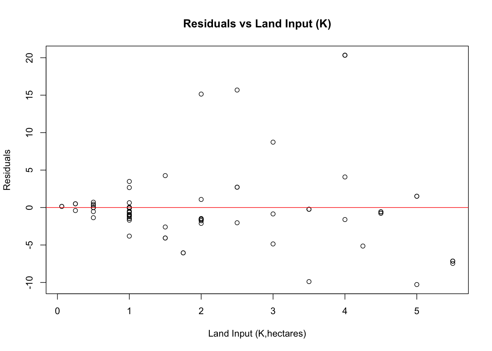
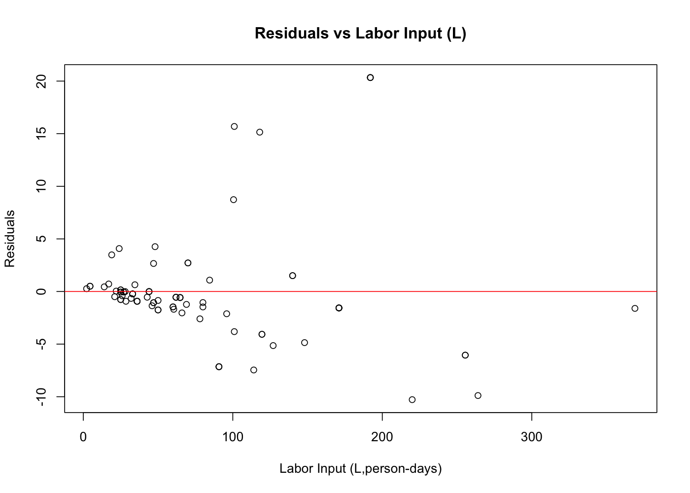
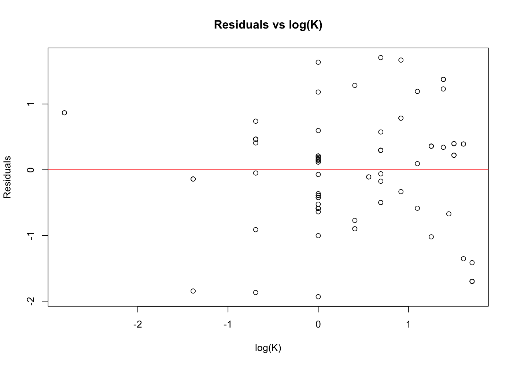
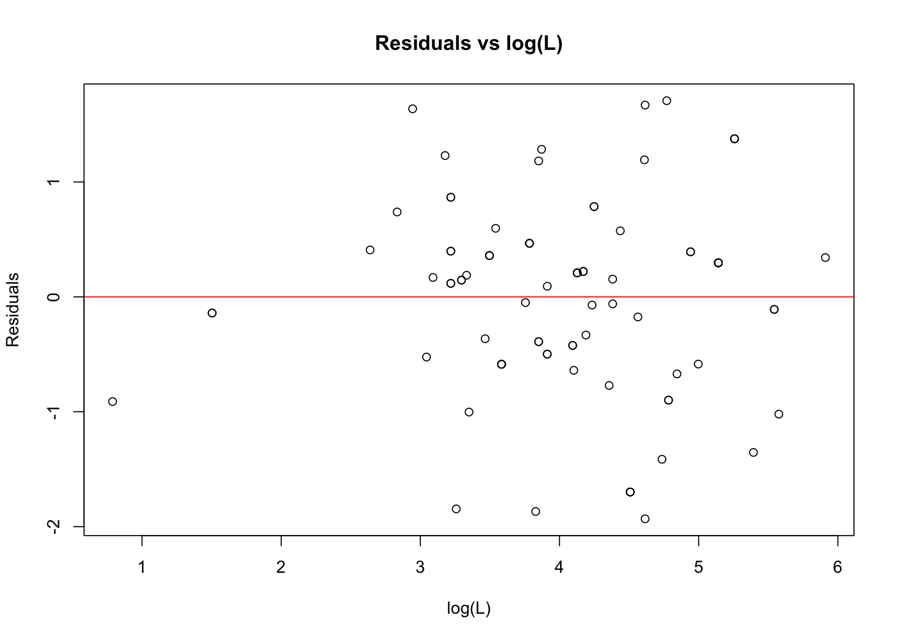

# Results from the original maize coursework

These outputs come from the two models in the repository's original `analysis.R`. The uploaded R script is unchanged; these files were exported separately with coding assistance. No additional models, controls, or alternative standard-error estimators were introduced.

## Files

- `model_summaries.txt`: Original commands and their output, including regression summaries, heteroskedasticity tests, robust inference for the linear model, and confidence intervals.
- `coefficient_results.csv`: Coefficients, standard errors, t statistics, p-values, 95% confidence intervals, and sample sizes. The linear model uses HC0 robust standard errors and the original 1.96 interval multiplier. The log-log model uses conventional OLS standard errors and the original `confint()` method.
- `heteroskedasticity_tests.csv`: The two original White-style auxiliary tests, implemented through the default studentized `bptest()`.

## Findings

Both models use 86 observations. In the linear model, one additional hectare of land is associated with approximately 1.014 additional metric tons of maize, holding labor constant. One additional person-day of labor is associated with approximately 0.039 additional metric tons, holding land constant.

In the log-log model, 1% more land is associated with approximately 0.647% more output, holding labor constant. Similarly, 1% more labor is associated with approximately 0.565% more output, holding land constant. These are approximate percentage interpretations of elasticities, not causal effects.

The heteroskedasticity test rejects constant error variance in the linear model (p = 0.00000671). It does not reject constant variance in the log-log model (p = 0.243). Non-rejection does not prove constant variance. The output preserves the original script's choice of standard errors and confidence-interval methods.

## Original residual plots

The plots below were exported from the original plotting commands. The red line marks a residual of zero.

Residuals are in metric tons in the linear model and log output units in the log-log model. Their numerical spreads are not directly comparable. R-squared values also should not be directly compared across these two outcome scales.

The raw course dataset is not included. These regressions describe associations and do not establish causal effects.
